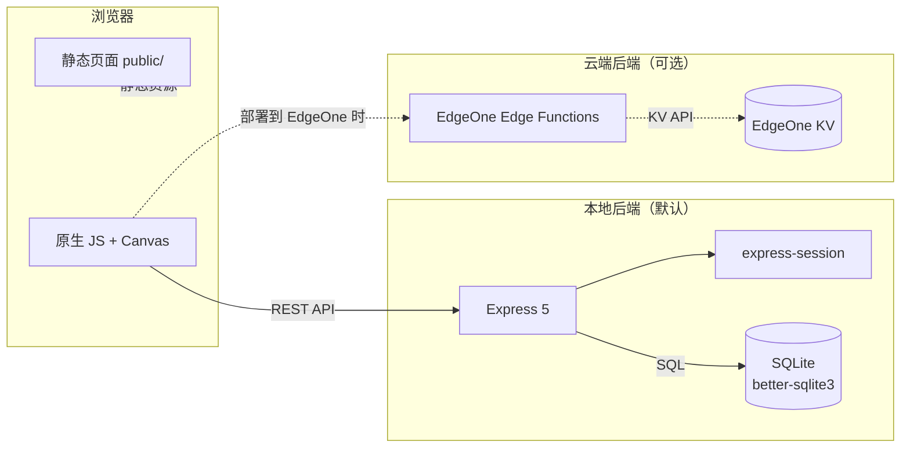
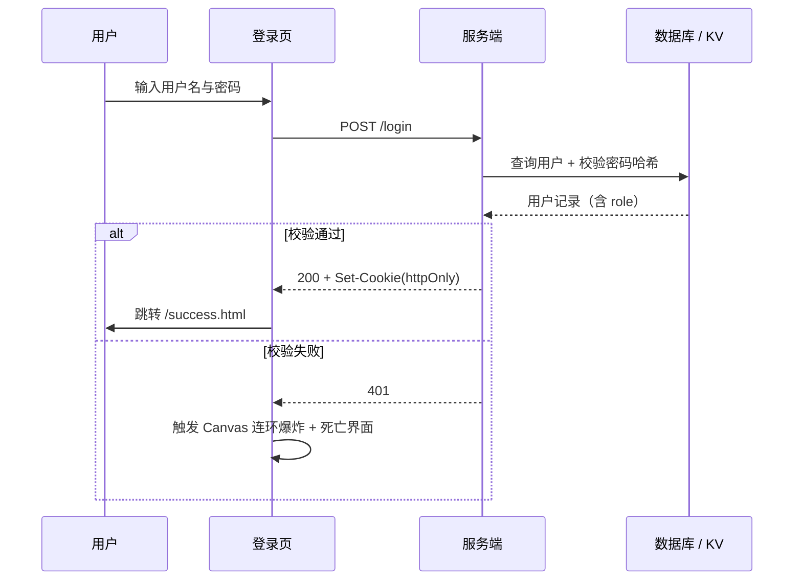
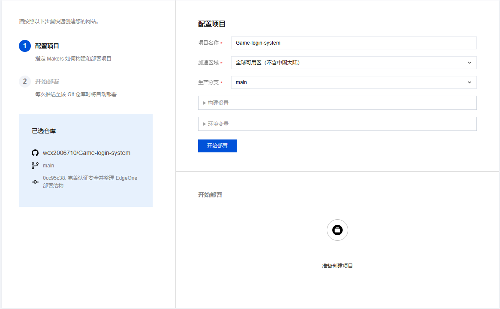

# 💣 Game Login System

<div align="center">

[](https://nodejs.org/)
[](https://expressjs.com/)
[](https://www.sqlite.org/)
[](./LICENSE)
[](https://github.com/wcx2006710/Game-login-system/actions/workflows/ci.yml)
[](#测试)
[](#️-edgeone-pages-云部署)

基于 Node.js 的交互式游戏登录系统 —— 登录失败会被炸飞，登录成功来一局扫雷。
支持**本地运行**与**腾讯云 EdgeOne Pages 云部署**（Edge Functions + KV 存储）两套后端。

</div>

---

## ✨ 功能矩阵

| 模块 | 能力 | 本地 | 云端 |
| :--- | :--- | :---: | :---: |
| 认证 | 登录 / 登出 / 会话管理 | ✅ | ✅ |
| 认证 | 注册新账号（开放注册） | ✅ | ✅ |
| 密码 | 本地 PBKDF2-SHA256 + 随机盐；云端 SHA-256 | ✅ | ✅ |
| 权限 | 角色 `user` / `admin`，每次请求实时读库 | ✅ | ✅ |
| 用户管理 | 管理员新增 / 编辑 / 删除用户、分配角色 | ✅ | ✅ |
| 个人中心 | 修改自己的邮箱与密码 | ✅ | ✅ |
| 数据展示 | 用户列表表格 + 角色徽章 | ✅ | ✅ |
| 数据可视化 | 统计卡片 + 角色分布饼图 + 注册增长折线图 | ✅ | ➖ |
| 交互 | Canvas 炸弹背景，点击引爆；登录失败全屏连环爆炸 | ✅ | ✅ |
| 游戏 | 9×9 经典扫雷（插旗 / 计时 / 胜负判定） | ✅ | ✅ |
| 安全 | 滑动窗口限流、httpOnly Cookie、安全响应头 | ✅ | ➖ |

> ➖ 表示云端版本当前未覆盖（EdgeOne 运行环境限制）。

## 🖥️ 页面一览

**当前版本**（`/` 根路径，科技感暗色玻璃拟态）

| 路径 | 说明 |
| :--- | :--- |
| `/index.html` | 落地页：粒子背景、功能特性、技术栈、测试账号 |
| `/login.html` | 登录页：Canvas 炸弹互动背景 + 失败死亡动画 |
| `/register.html` | 注册页：浮动标签、密码强度条、显示/隐藏密码 |
| `/success.html` | 登录成功：用户信息、管理区入口、用户列表 |
| `/profile.html` | 个人中心：账号信息、改邮箱、改密码 |
| `/admin.html` | 用户管理后台：统计卡片、Chart.js 图表、用户 CRUD |
| `/minesweeper.html` | 扫雷游戏 |

**旧版存档**（`/legacy/`，改造前原始界面，用于设计对比）

| 路径 | 对应新版 |
| :--- | :--- |
| `/legacy/index.html` | `/index.html` |
| `/legacy/login.html` | `/login.html` |
| `/legacy/register.html` | `/register.html` |
| `/legacy/success.html` | `/success.html` |
| `/legacy/profile.html` | `/profile.html` |
| `/legacy/admin.html` | `/admin.html` |
| `/legacy/minesweeper.html` | `/minesweeper.html` |

详见 [`public/legacy/README.md`](./public/legacy/README.md)。

## 🏗️ 架构



登录时序：



## 🛠️ 技术栈

| 层级 | 技术 |
| :--- | :--- |
| 本地后端 | Node.js 22 + Express 5 + SQLite（better-sqlite3） |
| 云后端 | 腾讯云 EdgeOne Pages Edge Functions + KV 存储 |
| 会话 | express-session（本地）/ Cookie + KV（云端） |
| 前端 | HTML5 + CSS3（自定义属性）+ 原生 JavaScript + Canvas |
| 可视化 | Chart.js 4.4.7（本地内置） |
| 动效 | tsParticles 3.8.1（本地内置）、自研 Canvas 粒子系统 |
| 图标 | Lucide Icons（内联 SVG，离线可用） |
| 测试 | Node.js 内置 `node --test` |
| 工程化 | GitHub Actions CI、Prettier、ESLint、Docker |

## 🚀 快速开始

```bash
cd local
npm install     # 安装依赖
npm start       # 启动服务
npm run dev     # 开发模式（文件变化自动重启）
npm test        # 运行本地 + 云端接口测试
```

浏览器访问 <http://127.0.0.1:3000>

> **零网络依赖**：所有第三方库已内置到 `public/vendor/`，断网环境下界面与图表同样完整可用。

### Docker

```bash
docker build -t game-login-system .
docker run --rm --network host -v game-login-data:/app/data game-login-system
```

> `server.js` 监听 `127.0.0.1`，因此容器需使用 `--network host`。
> 数据库目录通过卷 `/app/data` 持久化。

## 👤 测试账号

| 用户名 | 密码 | 角色 |
| :--- | :--- | :--- |
| `wcx` | `dashuaige` | 普通用户 |
| `admin` | `123456` | 管理员 |
| `test` | `test123` | 普通用户 |

## 📡 API 接口

| 方法 | 路径 | 权限 | 说明 |
| :--- | :--- | :--- | :--- |
| POST | `/login` | 公开 | 登录认证 |
| POST | `/logout` | 公开 | 退出登录 |
| POST | `/register` | 公开 | 注册新账号 |
| GET | `/api/current-user` | 公开 | 获取当前登录用户 |
| GET | `/api/users` | 登录 | 用户列表 |
| POST | `/api/users` | 管理员 | 新增用户 |
| PUT | `/api/users/:id` | 管理员 | 编辑用户（邮箱 / 角色 / 密码） |
| DELETE | `/api/users/:id` | 管理员 | 删除用户 |
| PUT | `/api/profile` | 登录 | 修改自己的邮箱 |
| POST | `/api/change-password` | 登录 | 修改自己的密码 |
| GET | `/api/health` | 云端 | KV 绑定健康检查 |

安全设计要点：

- **限流**：登录 15 分钟 5 次、注册 1 小时 10 次，滑动窗口
- **角色实时校验**：角色每次请求从数据库读取，不信任会话中的快照
- **自我保护**：管理员不能把自己降级、不能删除自己；内置 `admin` 账号不可删除
- **密码存储**：本地 PBKDF2-SHA256 + 随机盐（旧明文数据登录时自动升级为哈希）

## 🎨 设计系统

界面统一为**科技感暗色玻璃拟态**，所有设计令牌集中在 [`public/styles/theme.css`](./public/styles/theme.css)：

| 类别 | 令牌 | 说明 |
| :--- | :--- | :--- |
| 主色 | `--c-primary` `#667eea` | 按钮、聚焦态、链接 |
| 语义色 | `--c-info` `--c-success` `--c-warning` `--c-danger` | 状态提示 |
| 背景 | `--bg-space` 深空渐变 | 页面底层 |
| 玻璃层 | `--glass-bg` / `--glass-border` / `--glass-blur` | 毛玻璃卡片 |
| 圆角 / 阴影 | `--r-*` 8–999px / `--sh-1`~`--sh-3` | 形状与层次 |
| 层级 | `--z-bg` ~ `--z-overlay` | 粒子 / 内容 / Toast / 覆盖层 |
| 动效 | `--ease` `--t-fast` `--t-base` `--t-slow` | 统一过渡曲线 |

交互组件在 [`public/styles/components.css`](./public/styles/components.css) 与 [`public/js/ui.js`](./public/js/ui.js)：

| 组件 | 用途 |
| :--- | :--- |
| Toast | 替代区块内硬提示，右上角弹出、点击即关 |
| Button Spinner | 按钮 loading 态，替代文案替换 |
| Skeleton | 表格加载骨架屏 |
| 密码强度条 | 实时评分（自研算法，零依赖） |
| 浮动标签 | 聚焦/有内容时标签上浮 |

## ☁️ EdgeOne Pages 云部署

### 架构

```
客户端 → EdgeOne Pages 静态资源（public/）
       → Edge Functions（edge-functions/）处理 API
       → KV 存储（用户数据 + 会话）
```

### 部署步骤

1. **推送代码**：项目已含 `edgeone.json`（输出目录 `./public`），推送到 GitHub 即可

2. **创建 EdgeOne Pages 项目**
   - 打开 <https://console.cloud.tencent.com/edgeone/pages>
   - 「创建项目」→ 绑定 GitHub 仓库 `Game-login-system`
   - 构建配置：无构建命令，输出目录 `./public`
   - 部署分支：`main`

3. **开通 KV 存储并绑定**
   - Makers 控制台顶部导航 `KV Storage` → `Apply now`，提交申请等待开通
   - 开通后 `Create Namespace` 创建命名空间（如 `game-login-kv`）
   - 项目详情 → 左侧 `KV 存储` → `绑定命名空间`
   - **Variable Name 必须填 `my_kv`**（函数代码中的固定变量名）

4. **部署**：绑定完成后推送 `main` 分支自动触发构建



> 首次调用登录接口时 KV 会自动懒初始化默认账号，无需手动写入键值。

部署后访问 `GET /api/health` 校验绑定：

```json
{ "ok": true, "kv": true }
```

返回 `503 KV_UNAVAILABLE` 表示 `my_kv` 未绑定到当前项目/环境。

### 云端 Edge Functions

| 文件 | 路由 | 说明 |
| :--- | :--- | :--- |
| `edge-functions/login.js` | POST /login | 登录认证 |
| `edge-functions/logout.js` | POST /logout | 退出登录 |
| `edge-functions/register.js` | POST /register | 注册新账号 |
| `edge-functions/api/health.js` | GET /api/health | KV 健康检查 |
| `edge-functions/api/current-user.js` | GET /api/current-user | 当前登录用户 |
| `edge-functions/api/users.js` | GET /api/users · POST /api/users | 用户列表 / 新增（管理员） |
| `edge-functions/api/users/[id].js` | PUT · DELETE /api/users/:id | 编辑 / 删除用户 |
| `edge-functions/api/profile.js` | PUT /api/profile | 改邮箱 |
| `edge-functions/api/change-password.js` | POST /api/change-password | 改密码 |

## 🧪 测试

```bash
cd local
npm run test:local   # 本地接口集成测试（42 项）
npm run test:edge    # Edge Functions 逻辑测试（70 项）
npm test             # 两者都跑（共 112 项）
```

GitHub Actions 会在每次 push / PR 到 `main` 时自动执行测试与 Prettier 格式检查（见 [`.github/workflows/ci.yml`](./.github/workflows/ci.yml)）。

本地代码检查：

```bash
npx prettier --check "public/styles/**/*.css" "public/js/**/*.js" --ignore-path .prettierignore
npx eslint .
```

## 📁 项目结构

```
login-system/
├── local/                        # 本地后端（Express 5 + SQLite）
│   ├── server.js                 # 服务入口：路由、限流、安全头
│   ├── db.js                     # 建表 / 旧库补列 / 种子账号
│   ├── auth.js                   # PBKDF2 密码哈希与校验
│   └── package.json
├── edge-functions/               # EdgeOne 云函数（KV 版后端）
│   ├── login.js  logout.js  register.js
│   └── api/
│       ├── health.js  current-user.js  users.js  users/[id].js
│       ├── profile.js  change-password.js
├── public/                       # 静态资源（EdgeOne 输出目录）
│   ├── styles/
│   │   ├── theme.css             # 设计令牌 + 基础组件
│   │   └── components.css        # Toast / Spinner / Skeleton / 强度条
│   ├── js/
│   │   ├── icons.js              # Lucide 图标子集（内联 SVG）
│   │   └── ui.js                 # 交互工具：Toast / Spinner / 骨架屏 / 评分
│   ├── vendor/                   # 离线第三方库（含来源与 License 说明）
│   ├── legacy/                   # 旧版界面存档
│   ├── index.html  login.html  register.html
│   ├── success.html  profile.html  admin.html
│   ├── minesweeper.html  favicon.svg
├── docs/screenshots/             # 文档截图
├── test-local.mjs                # 本地接口测试
├── test-edge-functions.mjs       # 云端函数测试
├── edgeone.json                  # EdgeOne Pages 配置
├── Dockerfile  .dockerignore     # 容器化
├── .github/workflows/ci.yml      # CI
├── eslint.config.mjs  .prettierrc  .editorconfig
└── LICENSE                       # MIT
```

## 📦 第三方库与许可

| 库 | 版本 | 用途 | License |
| :--- | :--- | :--- | :--- |
| [tsParticles](https://github.com/tsparticles/tsparticles) | 3.8.1 | 首页/注册页粒子背景 | MIT |
| [Chart.js](https://github.com/chartjs/Chart.js) | 4.4.7 | 管理后台数据图表 | MIT |
| [Lucide Icons](https://github.com/lucide-icons/lucide) | 0.469.0 | 界面图标（内联 32 个 SVG） | ISC |
| Express | 5.x | Web 框架 | MIT |
| better-sqlite3 | 13.x | SQLite 驱动 | MIT |
| express-session | 1.19.x | 会话管理 | MIT |

第三方库文件与详细说明见 [`public/vendor/README.md`](./public/vendor/README.md)。

> 未引入 zxcvbn（gzip 后 398 KB，远超本项目静态资源总量），密码强度改用自研评分函数。

## 🗺️ 路线图

- [x] 注册、用户管理后台、个人中心
- [x] 云端 Edge Functions 与本地功能对齐
- [x] 统一设计系统与暗色玻璃拟态
- [x] 管理后台数据可视化
- [x] CI / Docker / 代码规范
- [ ] 云端版本补充数据图表接口
- [ ] 亮色主题切换
- [ ] 邮箱验证码找回密码

## 📄 许可

[MIT](./LICENSE) © 2026 Game Login System
